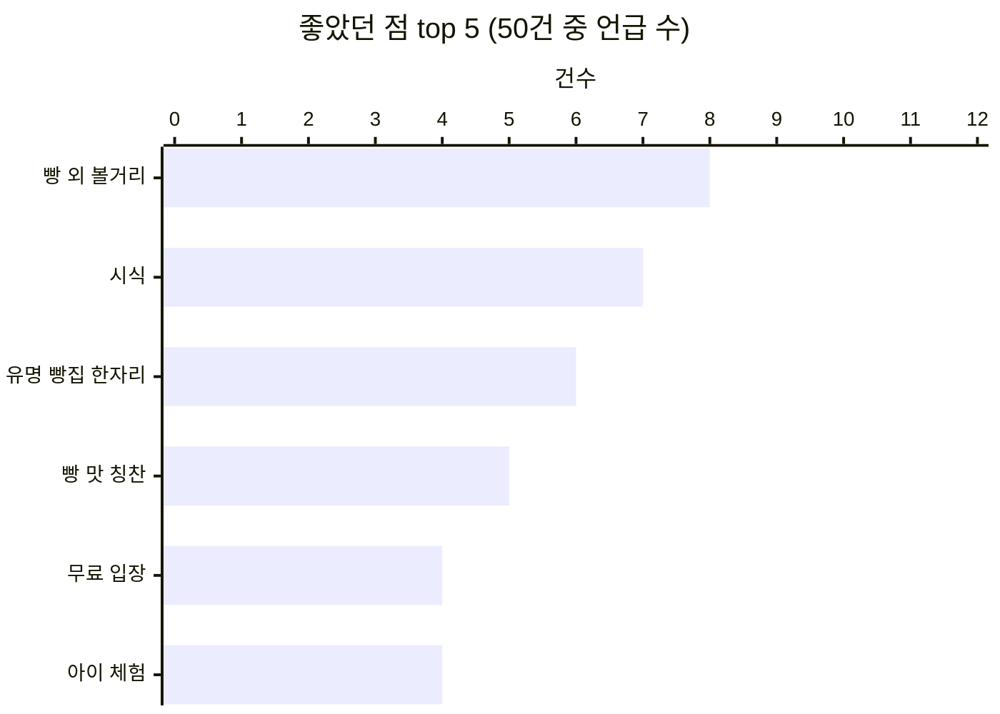
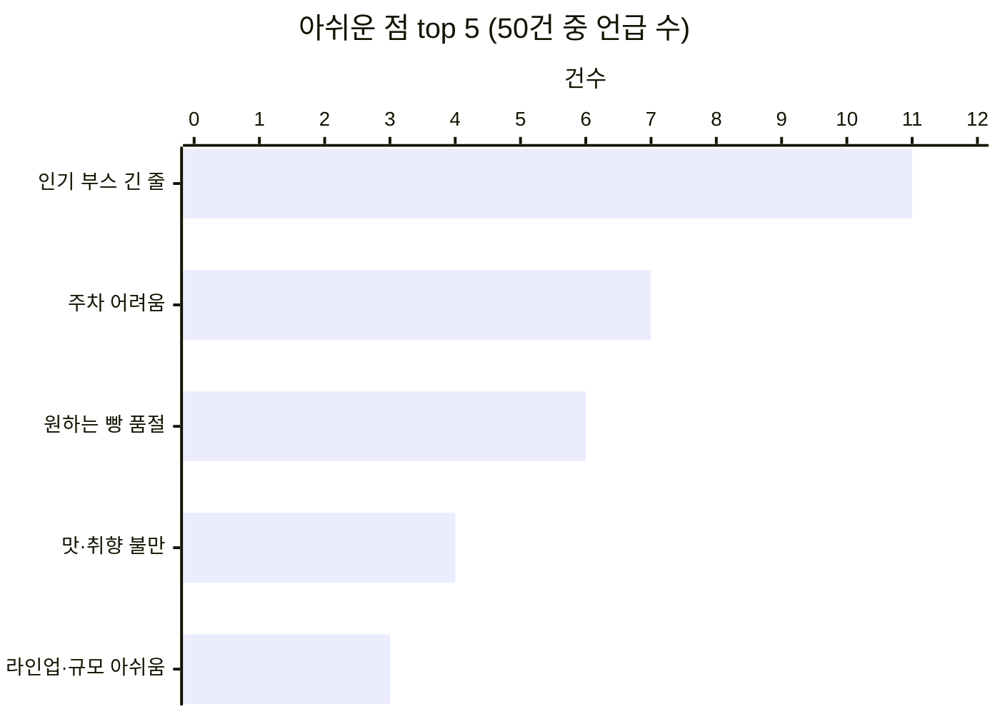

# 2026 광주빵페스타 블로그 후기 분석 (박대식)

분석 2026-11-16 · 자료: 같은 폴더 `reviews.csv` 50건 (네이버 블로그, 게시일 2026-10-23 ~ 11-13) · 출처: `sources.md`

## 분석 방법과 한계
- Claude가 50건의 본문(평가 문장 발췌)을 한 건씩 읽고 주제별로 분류함 **[Claude 판단]**. 아래 표의 "행 번호"는 reviews.csv의 `번호` 열 → 직접 대조 가능
- 한 후기가 여러 주제에 들어갈 수 있어 건수 합계는 50을 넘음
- 한계
  - 블로그 후기라 "좋았다" 쪽으로 기울 수 있음. 별점이 없어 점수화 불가
  - 본문은 발췌라 원문 전체 평가와 다를 수 있음
  - 평가 내용이 거의 없는 글 6건 (4·9·10·27·37·44): 4는 남의 후기를 옮긴 글, 9·10은 행사 소개 위주
  - 2026년만 해당. 행사 3일 중 토·일에 비가 와서 날씨 영향이 큼

## 1. 한눈에 보기

| 구분 | 주제 | 건수 | 행 번호 |
|---|---|---|---|
| 👍 좋았던 점 | 커피·책·플리마켓·소품 등 빵 외 볼거리 | 8 | 2, 7, 31, 38, 40, 42, 46, 49 |
| 👍 | 유명 빵집을 한자리에서, 종류 다양 | 6 | 6, 15, 18, 40, 46, 47 |
| 👍 | 시식 | 7 | 6, 18, 23, 24, 38, 40, 50 |
| 👍 | 특정 빵 맛 칭찬 | 5 | 14, 22, 25, 30, 38 |
| 👍 | 무료 입장 | 4 | 2, 12, 18, 29 |
| 👍 | 아이 체험 (케이크 만들기 등) | 4 | 6, 24, 28, 39 |
| 👎 아쉬운 점 | **인기 부스 긴 줄** | 11 | 8, 12, 17, 18, 23, 25, 30, 35, 39, 46, 47 |
| 👎 | **주차 어려움** (만차·갓길·단속) | 7 | 7, 11, 17, 20, 24, 48, 49 |
| 👎 | **원하는 빵 품절** | 6 | 11, 16, 18, 23, 25, 48 |
| 👎 | 맛·취향 불만 | 4 | 5, 7, 14, 25 |
| 👎 | 라인업·규모 아쉬움 (클래식 위주, 작년보다 볼거리 적음, 규모 작음) | 3 | 41, 45, 49 |
| 👎 | 행사 동시 개최로 혼잡 (빵페스타+취향의 발견+아트페어) | 1 | 7 |
| ➖ 날씨 | 비 언급 | 14 | 3, 11, 13, 14, 17, 19, 20, 21, 24, 26, 27, 32, 33, 36 |

## 1-1. 차트 — 좋았던 점·아쉬운 점 top 5 (언급 수)

- 같은 내용의 그림 차트: 같은 폴더 `review-chart.html` (브라우저로 열면 막대에 마우스를 올려 행 번호 확인 가능)
- 좋았던 점은 무료 입장·아이 체험이 4건으로 공동 5위라 둘 다 넣음

**비 언급 (차트 외)**
- 14건 (3, 11, 13, 14, 17, 19, 20, 21, 24, 26, 27, 32, 33, 36)
- 영향은 엇갈림: 한산·여유 (3, 32), 구경에 큰 불편 없음 (26) / 비 와도 사람 많음 (11, 20, 33), 우산 필요 (24), 아쉬움 (19)
- 야외 행사라 장소 변경이 어려워 개선 대상에서 제외 (광주빵페스타조사.md 11번)

## 2. 문제점 자세히

### 2-1. 줄과 품절 — 가장 많이 나온 불만
- 긴 줄 11건, 품절 6건. 줄 때문에 **구매를 포기**한 경우도 있음 (39)
- 품절 시각이 나온 후기
  - 11시쯤 궁전제과 베리프로마쥬 품절 → **오후에 다시 나온다고 함** (48)
  - 오후 1시, 먹고 싶던 빵 품절 많음 (11)
  - 점심 먹고 갔는데 이미 품절 (16)
  - 브레드홀릭은 **오후 3시에 마지막 물량**이 들어옴 → 맞춰 가서 구매 (22)
- 반대로 줄·품절이 없었다는 후기도 있음: 금요일 오픈 시간 (1), 비 오는 오후 (32), "품절 거의 없고 대기 줄도 없음" (35)
- → **시간대·요일·날씨에 따라 수요 차이가 큼**. 2026년에는 일부 부스가 **오후 재입고**를 하고 있었음 (22, 48) — 1회의 "오후 추가 준비 어려움"(무등일보 2025)에서 조금 나아진 신호

### 2-2. 주차
- 문제 7건: 만차·갓길 주차 (11, 24, 49), 협소·단속 (17), 진입 지연 (20), 여유 없음 (48), 아트페어 동시 개최로 주차장 포화 (7)
- 괜찮았다 7건: 1, 3, 12, 14, 28, 45, 50 — **이른 시간(14: 9시 도착)이나 첫날 금요일(45, 50)**에 괜찮았다는 후기가 많음
- 요금은 저렴하다는 평가 (12: 2시간 870원, 39)
- → 주말 낮 주차 수요가 몰림. 같은 날 다른 행사(아트페어·결혼식장)와 겹치는 문제 (7, 11)

### 2-3. 라인업·맛
- "클래식한 빵 위주, 유행빵은 두쫀쿠·쫀득빵 정도" (41)
- "작년에 비해 빵 볼거리가 많지 않은 느낌" (49)
- "규모가 큰 행사는 아니라 1시간이면" (45), "40분 만에 시식·구매 끝" (44)
- 맛 불만은 개인 취향 수준 (5, 7, 14, 25)

### 2-4. 날씨 (비)
- 비 언급 14건. 영향은 엇갈림
  - 비 덕분에 한산·여유 (3, 32), 행사장은 구경에 큰 불편 없음 (26)
  - 비가 와도 사람 많음 (11, 20, 33), 우산 필요 (24), 비 때문에 아쉬움 (19)

## 3. 좋았던 점 자세히
- **빵 외 프로그램이 호평**: 로컬 커피(로콜로컬), 북마켓(모두의 책장), 플리마켓, 소품·공예 → 2회에 새로 넣은 프로그램이 "일반 빵 축제와 다른 분위기"(42)로 평가됨
- **한자리에서 유명 빵집 비교** + **시식**이 핵심 만족 요인
- **무료 입장**, **아이 체험** → 가족 단위 방문 (3, 21, 28)
- 온누리 결제가 되는 부스가 많음 (35)

## 4. 지역 상권(시장경제)과 연결되는 후기
| 내용 | 행 |
|---|---|
| 축제에서 다 못 먹어 **"매장으로 찾아갈게요"** — 축제 → 매장 방문으로 이어짐 | 8 |
| 동네 **카페 사장이 디저트 메뉴 공부**하러 방문 | 13 |
| "우리 지역 상점들이 활기를 찾았으면" | 31 |
| 온누리 결제 가능 부스 많음 | 35 |
| 다른 지역 빵집(전주 풍년제과)도 참여 | 19 |
| 작년 품절로 못 갔다가 올해 방문 | 34 |

## 5. 공식 발표와 비교
| 공식 발표 (광주관광공사 보도자료 2026-10-26) | 후기에서 보이는 모습 |
|---|---|
| 2만5천 명 방문, 태풍 속에서도 성황 | 비가 와도 사람 많았다 (11, 20, 33). 다만 한산했다는 후기도 있음 (3, 32) |
| 빵·커피·책·플리마켓·러닝 결합 라이프스타일 축제 | 빵 외 프로그램 호평 8건 — 공식 평가와 일치 |
| 주변 식당 북적, 골목상권 활성화 | 후기에서는 주차장·주변 도로 혼잡으로 나타남 (7, 11, 20) |
| (언급 없음) | **긴 줄 11건, 품절 6건, 주차 문제 7건** — 공식 발표에 없는 불편 |

## 6. 시사점 **[Claude 제안]** — 광주빵페스타조사.md 8·9번 전략과 연결
1. **수요 예측이 필요한 근거**: 같은 행사에서도 시간대·요일·날씨에 따라 "줄 없음"(1, 32, 35)과 "1시에 품절"(11)이 공존 → 부스별·시간대별 준비 수량 예측(전략 A)이 효과 있을 자리
2. **재입고 시각 알림**: 이미 일부 부스가 오후 재입고 중 (22, 48) → "3시 마지막 물량" 같은 정보를 앱·현장 안내로 공개하면 줄 분산 (전략 B)
3. **주차·교통**: 주말 낮 + 동시 행사 때 포화 (7, 11) → 셔틀·대중교통 안내, 동시 행사 일정 조정 (전략 C)
4. **축제 → 매장 연결**: "매장으로 찾아갈게요"(8) 같은 수요를 쿠폰·스탬프로 동네 빵집 방문으로 이어가기 (전략 D)
5. **라인업 신선도**: 클래식 위주·작년보다 볼거리 적음 (41, 49) → 신규 빵집·한정 메뉴 비중 관리
6. **빵 외 프로그램 유지**: 좋았던 점 중 가장 많음 (8건) → 1인당 소비가 줄어든 원인 가설(빵 안 사는 방문객 증가)과 함께 볼 것. 프로그램 참여자의 빵 구매 연결(세트·쿠폰) 필요

## 7. 근거 리뷰 검증 — "빵 외 볼거리" (행 2, 7)

검증 2026-11-17 · 대상: 1번 표 👍 "커피·책·플리마켓·소품 등 빵 외 볼거리" (8건) 중 행 2, 7 · 본문은 `reviews.csv` 본문 열 그대로 · 판단은 **[Claude 판단]**

| 번호 | 리뷰 본문 (reviews.csv 그대로) | 판단 | 판단 이유 | 원문 출처 |
|---|---|---|---|---|
| 2 | 10.25(일) 장소: 김대중컨벤션센터 야외광장 (무료입장!) 입장료 없이 무료로 둘러볼 수 있어서 그런지 오전부터 맛있는 빵 냄새와 함께 많은 방문객분들로 축제 열기가 엄청나더라고요! 유명 로컬 로스터리 카페(ROCOL LOCAL)의 고소한 커피 향과 독립서점 '모두의 책장', 아기자기한 플리마켓 '존재의 숲'까지 구경거리가 가득해서 빵 쇼핑하는 내내 눈과 입이 즐거웠습니다 빵 먹으려고 뛰는 사람 모여라! 일이일오 호박인절미 베 (4) 2026에는 커피 맛집들도 즐비! | 맞음 | 커피(로콜로컬)·책(모두의 책장)·플리마켓(존재의 숲)을 직접 짚고 "구경거리가 가득"이라며 좋게 평가함 | [네이버 블로그, 2026-11-01](https://blog.naver.com/darkomdar2/224461486528) |
| 7 | 아쉬운건 빵페스타 + 취향의 발견 거기다가 아트페어까지 같이 해버리니까... 안그래도 주말 복작대는 김대중컨벤션 주차장 터져나감.... 너무 한방에 터트려서 좀 아쉬웠어요. 도자기 제품들도 많아서 구경하는 재미가 쏠쏠 그리고 한켠에는 밀리의서재 이벤트 그리고 광주 책방들이 나와있었어요. 빵에 커피 못참지. 요쪽은 커피 부스 좌라라 눈으로 보고 마지막날 끝내 사먹은 잠봉뵈르 포카치아! 맛은 짭짤할줄 알았는데 생각보다 싱겁...! | 맞음 | 도자기(소품)를 두고 "구경하는 재미가 쏠쏠"이라 했고, 책방·커피 부스도 언급함 | [네이버 블로그, 2026-10-27](https://blog.naver.com/nuhj553/224454823068) |

- 7번은 주차·동시 개최 불만과 맛 불만도 같이 있어 1번 표의 주차, 맛·취향 불만, 동시 개최 혼잡 항목에도 들어감. 볼거리 부분은 긍정이라 이 항목 근거로는 맞음
- 7번에서 좋게 평가한 건 도자기뿐이고, 책방·커피는 "있었다"는 사실 언급 → 주된 근거는 도자기
- 원문 찾은 방법: 2026-11-17 네이버 블로그 검색 (본문 속 문구로 검색) → 글을 열어 본문 문구와 게시일이 reviews.csv와 같은지 확인
- 원문 URL에는 작성자 블로그 아이디가 들어 있음 (sources.md 6번에서는 URL을 저장하지 않기로 했으나, 이 두 건은 사용자 요청으로 추가함)
