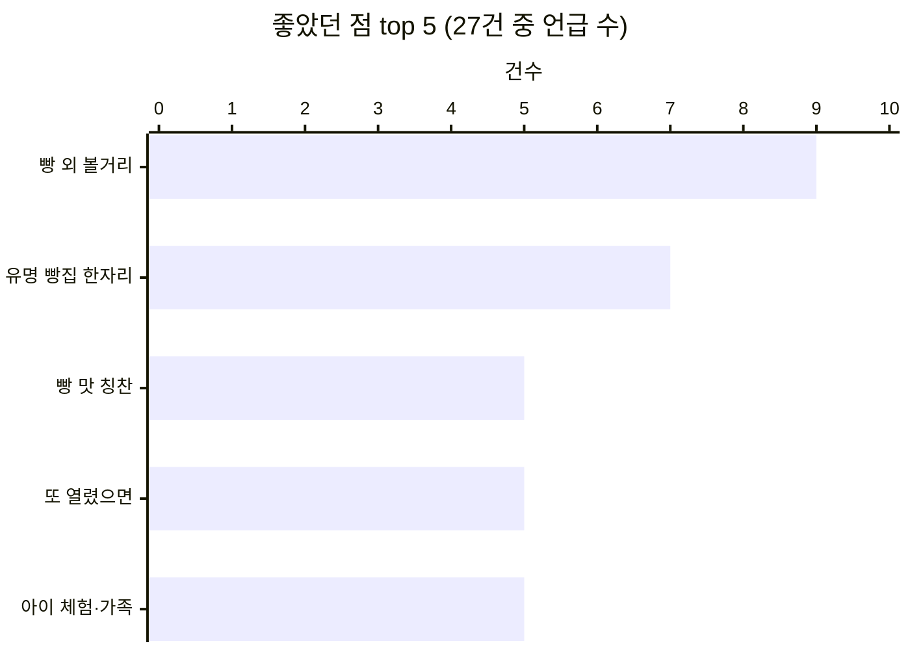
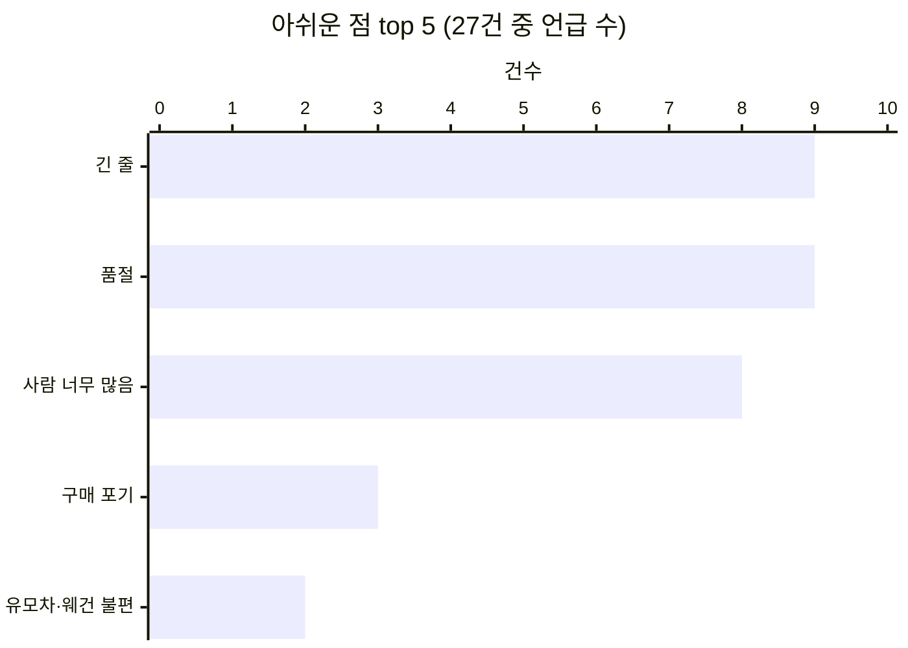

# 광주빵페스타 인스타그램 후기 분석 (박대식)

분석 2026-11-16 · 자료: 같은 폴더 `instagram.csv` 27건 (2025년 14건, 2026년 13건) · 출처: `instagram-sources.md`

## 분석 방법과 한계
- Claude가 27건 본문을 한 건씩 읽고 주제별로 분류함 **[Claude 판단]**. 괄호 숫자는 instagram.csv의 `번호`
- 한 게시물이 여러 주제에 들어갈 수 있어 합계는 27을 넘음
- 본문에 의견이 없는 게시물 6건은 댓글까지 확인했지만 행사를 평가한 댓글이 없었음 (질문·인사·이모지 위주) → 27건 모두 본문 의견
- 한계
  - 151건 중 직접 방문 후기는 33건뿐. 대부분 홍보·정보 글이라 표본이 작음
  - 검색 결과가 인기순이라 반응 많은 글 쪽으로 기울 수 있음
  - 인스타는 글이 짧아 평가가 한두 문장인 글이 많음 (12, 17, 21, 25)
  - 블로그 분석(2026년만)과 달리 2025·2026 두 해가 섞여 있음

## 1. 좋았던 점·아쉬운 점 top 5 (언급 수)

| 구분 | 주제 | 건수 | 행 번호 |
|---|---|---|---|
| 좋았던 점 | 빵 외 볼거리 (책방·커피·플리마켓·전시·경진대회) | 9 | 1, 2, 4, 7, 9, 13, 19, 20, 23 |
| 좋았던 점 | 유명 빵집을 한자리에서, 종류 다양 | 7 | 7, 15, 16, 18, 22, 23, 27 |
| 좋았던 점 | 특정 빵 맛 칭찬 | 5 | 4, 13, 15, 17, 26 |
| 좋았던 점 | "또 열렸으면, 또 가고 싶다" | 5 | 2, 4, 14, 15, 16 |
| 좋았던 점 | 아이 체험·가족 나들이 | 5 | 6, 7, 13, 19, 20 |
| 좋았던 점 | (6위) 시식 | 3 | 7, 15, 27 |
| 아쉬운 점 | 인기 부스 긴 줄 | 9 | 2, 5, 13, 15, 18, 20, 24, 26, 27 |
| 아쉬운 점 | 원하는 빵 품절 (8은 작년 품절 언급) | 9 | 8, 10, 11, 13, 21, 24, 25, 26, 27 |
| 아쉬운 점 | 사람이 너무 많음·혼잡 | 8 | 2, 4, 7, 8, 13, 23, 25, 27 |
| 아쉬운 점 | 줄 때문에 구매 포기 | 3 | 2, 18, 20 |
| 아쉬운 점 | 유모차·웨건 이동 불편 | 2 | 13, 27 |
| 아쉬운 점 | (6위) 주차장 만차 | 1 | 23 |

**비·날씨 언급 (차트 외)**
- 비 4건 (2, 4, 5, 6): 비가 와도 사람 많음 (2, 4), 비 때문에 일찍 귀가 (5), 비 오는 일요일에도 가족 단위 방문 (6)
- 맑은 날 1건 (12): "금요일 날씨 좋음" → 50만 원어치 구매
- 야외 행사라 장소 변경이 어려워 개선 대상에서 제외 (광주빵페스타조사.md 11번)

## 2. 1회(2025) vs 2회(2026) — 품절·줄이 줄었나

| 주제 | 2025 (14건) | 2026 (13건) |
|---|---|---|
| 품절 | 5건 (21, 24, 25, 26, 27) — "오후 1시 거의 다 매진", "2시에 솔드아웃 많음" | 3건 (10, 11, 13) — "바로 안 사면 없음", "품절 주의" 수준 |
| 긴 줄 | 6건 (15, 18, 20, 24, 26, 27) | 3건 (2, 5, 13) — "3군데 정도만 줄이 길고 나머지는 바로 구매" (5) |
| 구매 포기 | 2건 (18, 20) | 1건 (2) |

- 2026년 글에 개선을 직접 느낀 문장이 있음: "작년보단 참여 부스가 늘었고 빵 수량도 많은 것 같음" (8), 품절돼도 "재입고 예정 시간을 물어보세요" (7)
- → 2회에 수량·부스를 늘린 효과가 후기에서도 보임. 다만 인기 부스 몇 곳의 긴 줄은 그대로 (5, 13) **[Claude 판단, 표본 작음]**

## 3. 지역 상권(시장경제)과 연결되는 글

| 내용 | 행 |
|---|---|
| 줄이 길어 "나중에 차분하게 가게로 가지 뭐" → 축제가 매장 방문 수요로 이어짐 | 18 |
| 근처 동네 빵집이 참가해 반가움, "광주 기반의 빵집이 잘 되면 좋겠네요" | 4 |
| 축제 왔다가 카페 도장깨기로 "남의 동네 새로운 카페"를 알게 됨 | 1 |
| 빵 굽는 카페 운영자가 요즘 인기 빵을 배우러 방문 | 3 |
| 줄 기다리는 동안 근처 맛집·카페에서 밥·차 → 주변 상권 소비 | 18 |
| 김치축제·아트페어 등 같은 시기 행사와 묶어서 방문 | 6, 19, 22 |

## 4. 블로그 후기와 비교

| 항목 | 블로그 50건 (2026) | 인스타 27건 (2025+2026) |
|---|---|---|
| 아쉬운 점 1위 | 긴 줄 11건 (22%) | 긴 줄·품절 9건씩 (33%) |
| 주차 | 7건 (14%) — 2위 | 1건 (4%) |
| 좋았던 점 1위 | 빵 외 볼거리 8건 | 빵 외 볼거리 9건 — **같음** |
| 시식 | 7건 | 3건 |
| 아이 체험·가족 | 아이 체험 4건 | 체험·가족 5건 |
| 같은 날 다른 행사 | 혼잡 원인으로 부정적 (블로그 7) | 함께 즐겼다는 긍정 (인스타 6) |

- 두 자료 모두 **빵 외 볼거리가 좋았던 점 1위**, **줄·품절이 아쉬운 점 상위**로 같음
- 주차는 블로그에서만 크게 나옴. 인스타는 짧은 글이라 이동·주차 이야기를 덜 쓰는 것으로 보임 **[Claude 판단]**

## 5. 시사점 **[Claude 제안]** — 광주빵페스타조사.md 8·9·11번과 연결
1. **2회 수량 증가 효과 확인 → 3회는 인기 부스 집중 관리**: 품절·줄은 줄었지만 인기 부스 몇 곳은 여전 (5, 13) → 부스별 판매량 예측으로 인기 부스에 수량·인력 더 배정 (전략 A)
2. **재입고 시각 공개**: 후기 작성자가 직접 "재입고 시간 물어보라"고 안내할 정도 (7) → 부스별 재입고 시각을 현장·SNS로 공지 (전략 B)
3. **"나중에 가게로" 수요 잡기**: 줄을 포기한 손님이 매장 방문을 생각함 (18) → 줄 포기 손님에게 매장 쿠폰·픽업 예약 (전략 D, 11번 P4)
4. **체험·책방·커피는 계속 강점**: 두 자료 모두 1위 → 체험 참가자를 빵 구매로 잇는 아이디어(11번 E1~E7)가 효과 있을 자리
5. **유모차·가족 동선**: 혼잡 속 유모차·웨건 불편 (13, 27) → 가족 동선·유모차 보관 공간 검토
