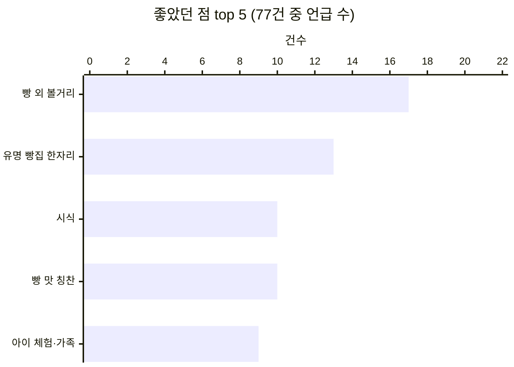
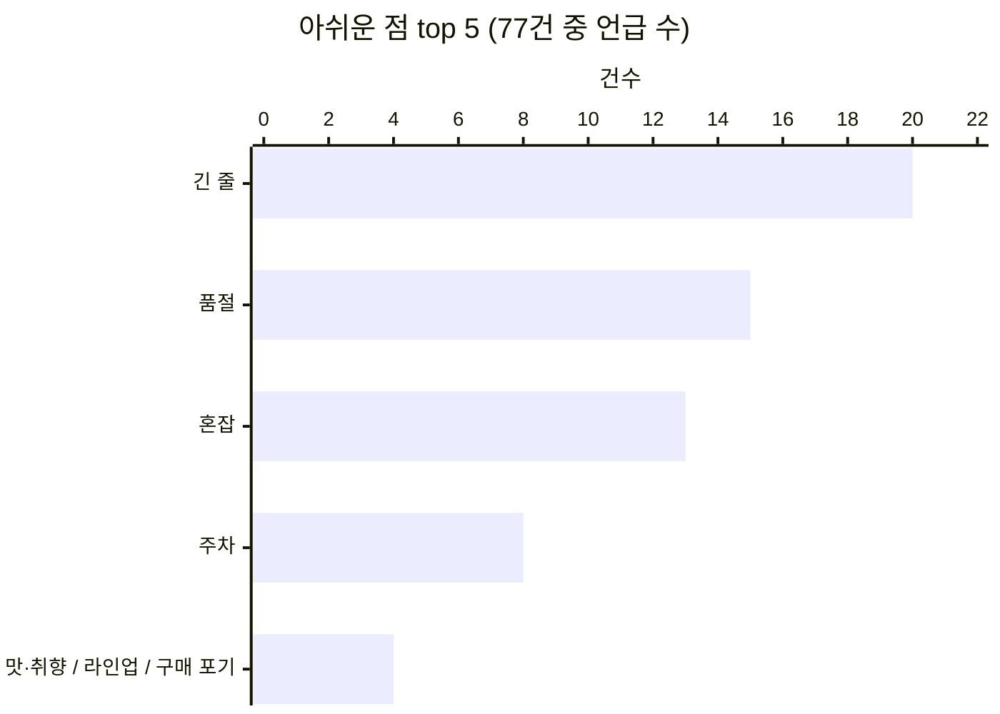

# 광주빵페스타 후기 통합 인사이트 리포트 (박대식)

분석 2026-11-17 · 자료: 같은 폴더 `all-reviews.csv` 77건 = 네이버 블로그 50건(`reviews.csv`) + 인스타그램 27건(`instagram.csv`) · 출처: `sources.md`, `instagram-sources.md`

## 분석 방법과 한계
- `all-reviews.csv` 열: 번호(1~77 통합 번호) · 출처(네이버 블로그/인스타그램) · 원번호(원래 파일의 번호) · 대상 · 날짜 · 별점 · 의견출처 · 본문
  - 번호 1~50 = 블로그 (원번호와 같음), 51~77 = 인스타 (원번호 + 50)
  - 아래 `#번호`는 모두 all-reviews.csv의 통합 번호
- 주제 분류는 기존 `analysis.md`(블로그)·`instagram-analysis.md`(인스타) 분류를 그대로 합침 **[Claude 판단]**. 새로 분류한 것은 블로그의 "사람 너무 많음"(#8, 11, 19, 20, 33) 1개뿐
- 한 후기가 여러 주제에 들어갈 수 있어 건수 합계는 77을 넘음
- 한계
  - 연도 섞임: 2026년(2회) 63건 (블로그 50 + 인스타 13), 2025년(1회) 14건 (인스타만)
  - 블로그는 최신순, 인스타는 인기순으로 모아서 뽑는 방식이 다름 → 연도 비교는 참고용
  - 블로그 후기라 긍정 쪽으로 기울 수 있고, 본문은 발췌라 원문 전체와 다를 수 있음
  - 평가가 거의 없는 글: #4, 9, 10, 27, 37, 44 (블로그), #67 (인스타, "맛있는 빵 많다." 한 줄)

## 1. 한눈에 보기 (77건 통합)

| 구분 | 주제 | 블로그 | 인스타 | 합계 | 근거 (#통합 번호) |
|---|---|---|---|---|---|
| 👍 | 빵 외 볼거리 (커피·책·플리마켓·소품·전시) | 8 | 9 | **17** | #2, 7, 31, 38, 40, 42, 46, 49, 51, 52, 54, 57, 59, 63, 69, 70, 73 |
| 👍 | 유명 빵집 한자리, 종류 다양 | 6 | 7 | **13** | #6, 15, 18, 40, 46, 47, 57, 65, 66, 68, 72, 73, 77 |
| 👍 | 시식 | 7 | 3 | **10** | #6, 18, 23, 24, 38, 40, 50, 57, 65, 77 |
| 👍 | 특정 빵 맛 칭찬 | 5 | 5 | **10** | #14, 22, 25, 30, 38, 54, 63, 65, 67, 76 |
| 👍 | 아이 체험·가족 나들이 | 4 | 5 | **9** | #6, 24, 28, 39, 56, 57, 63, 69, 70 |
| 👍 | "또 열렸으면" | 0 | 5 | 5 | #52, 54, 64, 65, 66 |
| 👍 | 무료 입장 | 4 | 0 | 4 | #2, 12, 18, 29 |
| 👎 | **인기 부스 긴 줄** | 11 | 9 | **20** | #8, 12, 17, 18, 23, 25, 30, 35, 39, 46, 47, 52, 55, 63, 65, 68, 70, 74, 76, 77 |
| 👎 | **원하는 빵 품절** | 6 | 9 | **15** | #11, 16, 18, 23, 25, 48, 58, 60, 61, 63, 71, 74, 75, 76, 77 |
| 👎 | 사람 너무 많음·혼잡 | 5 | 8 | **13** | #8, 11, 19, 20, 33, 52, 54, 57, 58, 63, 73, 75, 77 |
| 👎 | 주차 어려움 | 7 | 1 | **8** | #7, 11, 17, 20, 24, 48, 49, 73 |
| 👎 | 맛·취향 불만 | 4 | 0 | 4 | #5, 7, 14, 25 |
| 👎 | 라인업·규모 아쉬움 | 3 | 1 | 4 | #41, 45, 49, 68 |
| 👎 | 줄 때문에 구매 포기 | 1 | 3 | 4 | #39, 52, 68, 70 |
| 👎 | 유모차·웨건 이동 불편 | 0 | 2 | 2 | #63, 77 |

## 2. 인사이트 **[Claude 판단]**

### 인사이트 [1] 빵 외 볼거리가 만족 1위 — 두 자료 모두 같음
- 좋았던 점 중 가장 많음: 17건 (블로그 8 · 인스타 9). 출처가 달라도 1위가 같음
- 근거: #2 (커피·책방·플리마켓 "구경거리가 가득"), #7 (도자기 "구경하는 재미가 쏠쏠"), #42 ("일반적인 빵 축제와는 또 다른 분위기"), #57 ("빵만 있는 줄 알았는데 구경할 게 왜 이렇게 많아요"), #70 ("빵보다 체험이랑 판매 부스가 더 좋았는데")
- 의미: 줄·품절로 빵을 못 사도 볼거리가 만족을 받쳐 줌 (#70은 줄을 포기했지만 체험·부스로 만족)

### 인사이트 [2] 불만의 중심은 "줄 + 품절" — 수요가 공급보다 큼
- 긴 줄 20건, 품절 15건, 구매 포기 4건. 아쉬운 점 1·2위
- 근거: #52 ("줄이 진짜 어마어마해서 먹고 싶었던 빵들은 포기"), #68 ("줄 구경만 하다가 빈손으로"), #74 ("오후 1시 이미 거의 다 매진"), #11 ("1시쯤… 품절이 많았어요")
- 의미: 이 축제의 가장 큰 문제는 볼거리가 아니라 **인기 빵의 수량·판매 속도**

### 인사이트 [3] 품절은 시간대에 몰림 — 오전 늦게~오후 1시
- 품절 시각이 나온 글: 11시 일부 품절 (#48, 77), 오후 1시 품절 많음 (#11, 74), 점심 후 품절 (#16), 2시 솔드아웃 많음 (#76), 오후 거의 마감 (#71)
- 반대로 줄·품절이 없었던 때: 금요일 오픈 (#1), 평일 (#60), 비 오는 오후 (#32), 줄 없음 (#35), "3군데만 줄이 길고 나머지는 바로 구매" (#55)
- 의미: 같은 행사라도 **요일·시간·날씨에 따라 수요가 크게 다름** → 시간대별 준비 수량을 예측할 근거

### 인사이트 [4] 2회(2026)에서 품절·줄이 줄어든 신호 — 다만 인기 부스는 그대로
| 주제 | 2025 (14건) | 2026 (63건) |
|---|---|---|
| 품절 | 5건 (36%) | 9건 (14%) |
| 긴 줄 | 6건 (43%) | 14건 (22%) |
| 구매 포기 | 2건 (14%) | 2건 (3%) |
- 2026년 글에 개선을 직접 느낀 문장: "작년보단 참여 부스가 늘었고 빵 수량도 많은 것 같음" (#58), 오후 재입고 (#22 "3시에 마지막 물량", #48 "오후에 또 나온다", #57 "재입고 예정 시간을 물어보세요")
- 그래도 인기 부스 몇 곳은 줄이 여전함 (#55, 63, 39)
- 품절 합계 15건 중 #58은 2026년 글에서 "작년엔… 대부분 품절"이라고 2025년 품절을 말한 것이라 위 연도 표에서는 뺌
- ⚠️ 2025는 인스타 14건뿐이고 2026은 블로그가 대부분이라 비율 차이를 그대로 믿기는 어려움

### 인사이트 [5] 주차는 블로그에서만 큰 불만 — 주말 낮 + 동시 행사 때 포화
- 주차 문제 8건 중 7건이 블로그. 인스타는 짧은 글이라 이동 이야기를 덜 씀
- 포화 원인: 아트페어·취향의 발견 동시 개최 (#7), 결혼식장·다른 축제와 겹침 (#11), 주말 점심 (#11, 24)
- 괜찮았던 때: 9시 도착 (#14), 금요일 (#45, 50)

### 인사이트 [6] 축제가 동네 빵집·카페 방문으로 이어짐
- "매장으로 찾아갈게요" (#8), 줄 포기 후 "나중에 차분하게 가게로 가지 뭐" (#68), 카페 도장깨기로 "남의 동네 새로운 카페"를 알게 됨 (#51)
- 카페 운영자가 디저트·인기 빵을 배우러 방문 (#13, 53)
- 지역 빵집 응원: "광주 기반의 빵집이 잘 되면 좋겠네요" (#54), "우리 지역 상점들이 활기를" (#31)
- 의미: 축제에서 못 산 수요가 **매장 방문 수요**로 남아 있음

### 인사이트 [7] 가족 단위 방문이 많고, 혼잡 속 동선이 불편
- 아이 체험·가족 9건 (#6, 24, 28, 39, 56, 57, 63, 69, 70)
- 혼잡 13건 + 유모차·웨건 불편 2건 (#63 "부딪힘 주의", #77 "웨건은 정말 비추"), 아이와 웨이팅 포기 (#70)

## 3. 시사점 **[Claude 제안]** — 광주빵페스타조사.md 8·9·11번 전략과 연결
1. **시간대별 수요 예측 (인사이트 2·3)**: 요일·시간·날씨별로 준비 수량을 나눠 오전 늦게~오후 1시 품절 구간을 줄임 (전략 A)
2. **재입고 시각 공개 (인사이트 3·4)**: 이미 일부 부스가 오후 재입고 중 (#22, 48) → 부스별 재입고 시각을 현장·SNS로 알려 줄 분산 (전략 B)
3. **인기 부스 집중 관리 (인사이트 4)**: 전체 수량은 늘었지만 인기 몇 곳은 그대로 → 인기 부스에 수량·인력·줄 정리 더 배정
4. **주차·교통 (인사이트 5)**: 동시 행사 일정 조정, 주말 낮 셔틀·대중교통 안내 (전략 C)
5. **축제 → 매장 연결 (인사이트 6)**: 줄 포기·품절 손님에게 매장 쿠폰·픽업 예약 (전략 D)
6. **볼거리 유지 + 빵 구매 연결 (인사이트 1·7)**: 만족 1위인 볼거리·체험은 유지하고, 체험 참가자를 빵 구매로 잇는 세트·쿠폰 검토. 가족 동선·유모차 보관 공간도 함께 검토
